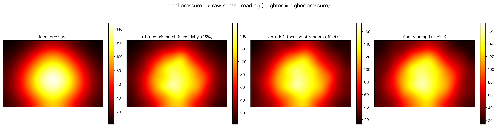
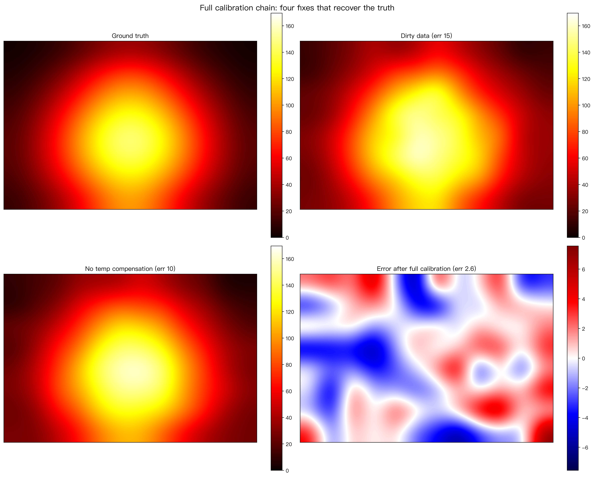
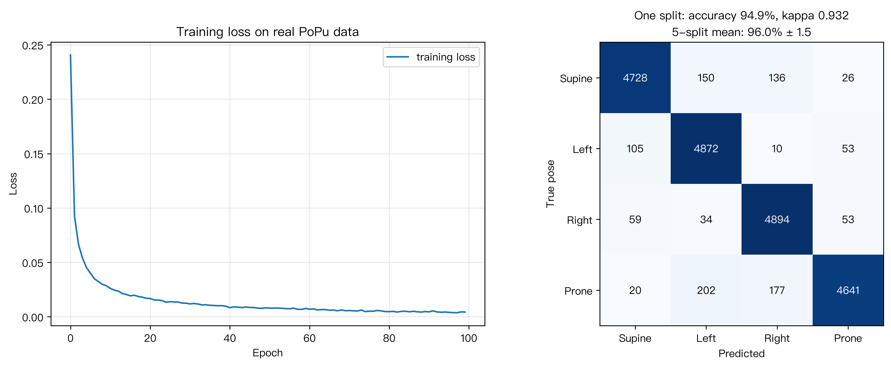
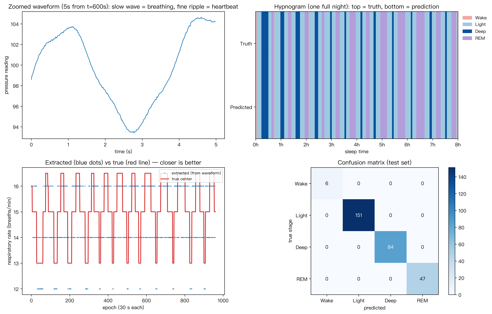

# Somnia

[中文版](README.zh-CN.md)

[](https://github.com/banzaicolo/Somnia/actions)


Somnia reads your sleep from a single mattress. No wearables, no cameras, no cloud.

It's a research playground for a flexible pressure-sensor mattress. It simulates dirty sensor data, cleans it up with a calibration pipeline, and builds the first applications on top: sleep posture, bed-exit detection, breathing and heart rate, and sleep staging. The posture classifier is also trained on real data from 60 volunteers (the PoPu dataset), reaching 96.0% ± 1.5 accuracy across five independent splits by people it has never seen.



## Quick start

```bash
pip install -r requirements.txt

python src/pressure_simulator.py
python src/calibration_demo.py
python src/train_pose_classifier.py
python src/bed_monitor_demo.py
python src/bcg_demo.py
python src/sleep_staging_demo.py
python src/sleep_pipeline_demo.py
python src/download_pupu.py full
python src/pupu_demo.py
python src/train_real_pose.py
```

Plots are written to `outputs/`.

## What's in here

| File | What it does |
|---|---|
| `pressure_simulator.py` | Synthetic pressure maps with five sensor defects |
| `calibration.py` | Crosstalk, temperature drift, zero offset, gain, hysteresis |
| `train_pose_classifier.py` | Posture classifier, a small MLP written in pure NumPy |
| `bed_monitor.py` | Bed-exit detection with an "away too long" alarm |
| `bcg_monitor.py` | Breathing and heart rate from the ballistocardiogram |
| `sleep_staging.py` | Four-stage sleep classification (wake / light / deep / REM) |
| `sleep_pipeline.py` | The whole chain, from raw waveform to sleep stages |
| `pupu_loader.py` | Loads PoPu data and removes the zero offset |
| `train_real_pose.py` | Posture training on 60 real volunteers |
| `main_controller.py` | Threaded edge-controller skeleton |



## Data

Most demos run on synthetic signals, generated with known ground truth. They prove the algorithms are logically correct, but say nothing about real-world performance.

The posture classifier also trains on [PoPu-Data](https://github.com/rdionisio1403/PoPu) (CC0), real pressure maps from 60 volunteers. There are two ways to evaluate it:

| Evaluation | Accuracy | Meaning |
|---|---|---|
| Random split | 99.5% | The model has partly seen the person before — inflated |
| **By volunteer (5 splits)** | **96.0% ± 1.5** | Test people were never in training — the number that matters |
| Random guessing | 25.0% | Baseline for four balanced classes |

Cohen's κ is 0.947 ± 0.020 across the five by-volunteer splits. Training uses all 10 frames per recording plus a left/right mirror augmentation: flipping a side-lying pressure map and swapping the left ↔ right label teaches the model the physical symmetry instead of making it memorise each side separately.



To fetch the dataset:

```bash
python src/download_pupu.py preview
python src/download_pupu.py full
```



## Evaluation protocol

Which numbers to trust, and why:

- test sets are split by **volunteer**, never by frame — frames from the same recording are highly correlated, so a frame-level split leaks information and inflates accuracy;
- the normalisation constant is a fixed global value, not computed from the test set;
- each volunteer's zero baseline comes from that volunteer's own empty-bed recording;
- the headline number is the mean and spread over five independent by-volunteer splits, not a single lucky split.

## Tests

```bash
pip install -r requirements-dev.txt
pytest
```

## Disclaimer

Somnia is research software, not a medical device. The alarm logic runs on synthetic data and has not been clinically validated, and accuracy on public datasets does not imply clinical performance. Do not use it for diagnosis or monitoring.

## Data & privacy

Everything runs offline by default — no data leaves the room. In a real deployment, mattress pressure signals are sensitive health data, and operators must follow the regulations that apply (PIPL, GDPR, and so on). This repository contains no identifiable subject data, and the PoPu dataset is not redistributed here.

## License

[MIT](LICENSE)

## Citation

See [CITATION.cff](CITATION.cff).
